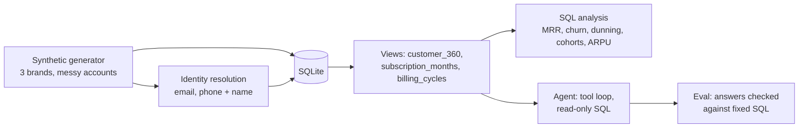

# customer-360-payments-lab

Accounts from three brands (news, sports, tv) are merged into one customer view. The lab then measures subscription revenue, churn and failed payments in SQL, and adds a small agent that answers questions over the data with read-only SQL.

Everything runs with Python's standard library and SQLite. The agent uses a local model through Ollama by default, so it needs no API key. All data is synthetic, and the generator's rates were set by hand. The results show the method; they say nothing about any real market or company.

[](https://github.com/oguzhanozfe/customer-360-payments-lab/actions/workflows/ci.yml)



## Run it

```bash
python3 -m unittest discover -s tests -v
python3 scripts/run_analysis.py          # builds data/lab.sqlite and prints every query
python3 -m lab.ask "Which decline code loses the most cycles, and how many are recovered?"
python3 eval/run.py                       # needs Ollama with qwen3.5:4b, or set LLM_BASE_URL / LLM_MODEL / LLM_API_KEY
```

Python 3.9 or newer works. Any OpenAI-compatible endpoint can stand in for Ollama.

## What is in it

**1. Single customer view.** The same person signs up on different brands with the same email written differently (case, Gmail dots, `+tags`), with phone numbers in four formats, or with the name typed with or without Turkish letters. [`lab/resolve.py`](lab/resolve.py) normalizes these fields and links accounts with union-find:

- Same normalized email: same person.
- Same normalized phone **and** same name: same person. A phone alone is not enough, because families share a number.

The generator knows who each account really belongs to, so the matching can be scored:

| Rule set | Precision | Recall |
|---|---:|---:|
| email, or phone + name (used) | 100.0% | 92.4% |
| email, or phone alone | 86.2% | 92.4% |

The 7.6% of links it misses are people who used a different email on one brand and shared no phone. Without another key, such as a login ID or a payment-card token, nothing in the data can link them.

**2. Payments and churn SQL** ([`sql/analysis/`](sql/analysis/), output in [`docs/RESULTS.md`](docs/RESULTS.md)):

| Query | Question |
|---|---|
| `01_data_quality` | Orphan payments, double-paid cycles, unmapped accounts. Every check must return 0 before any metric is read. |
| `02_identity_summary` | How many accounts became how many customers, and by which rule |
| `03_mrr_by_month` | MRR (yearly plans count as price/12) and active subscribers, with a window function for month-over-month change |
| `04_churn_split` | Monthly churn split into voluntary (cancelled) and involuntary (payment failed) |
| `05_payment_failures` | First-attempt declines by code and how many dunning retries recovered |
| `06_dunning_curve` | Cumulative recovery by retry (day 1, 3, 7) |
| `07_cohort_retention` | Share of each start-month cohort still subscribed at months 1, 3, 6 and 12, shown only once the whole cohort has aged |
| `08_arpu` | Revenue, ARPU, ARPPU and payer share by month |
| `09_cross_brand` | One-brand vs multi-brand customers, per subscription |

**3. Ask the data.** [`lab/ask.py`](lab/ask.py) is a hand-written tool-calling loop with two tools, `describe_schema` and `run_sql`. The database is opened read-only, and a SQLite authorizer refuses anything other than SELECT, so the model cannot write even if a prompt tells it to. Every query it runs is printed with the answer.

**4. Evaluation.** [`eval/run.py`](eval/run.py) asks 8 questions whose correct numbers come from fixed SQL. On `qwen3.5:4b`, one run, **6/8 answers were correct**. Both failures looked plausible:

- A grain mistake counted a monthly view across every month.
- A loose reading of "retries finished" gave 22.8% where the defined metric is 23.2%.

[`eval/RESULTS.md`](eval/RESULTS.md) explains both. The prompt was not tuned on this set afterwards.

## What the synthetic numbers show

From [`docs/RESULTS.md`](docs/RESULTS.md); see [`docs/decision-note.md`](docs/decision-note.md) for the reading:

- Involuntary churn is about a third of all churn, roughly 2% of subscriptions a month next to roughly 4% voluntary.
- `insufficient_funds` and `3ds_failed` recover well on retry (84-85%). `expired_card` (23%) and `fraud_suspected` (9%) mostly do not. Retrying a dead card is wasted effort; asking the customer to update the card is the fix.
- Retries recover 37% of failed cycles by the first retry and 67% by the third.

## Limits

- The generator decides the rates, so the analysis finds what was put in. The value is in the method: the checks, the definitions and the traps.
- SQLite stands in for a warehouse. The SQL is standard apart from the date functions, which differ per engine.
- Identity resolution is deterministic rules only. A real setup would add a login or card-token key and probabilistic matching, with a review queue for uncertain pairs.
- Dunning is a fixed schedule (day 1, 3, 7). It has no card-updater service, no pre-expiry reminders and no grace period.

Built with Claude Code as a coding assistant.

## License

MIT
